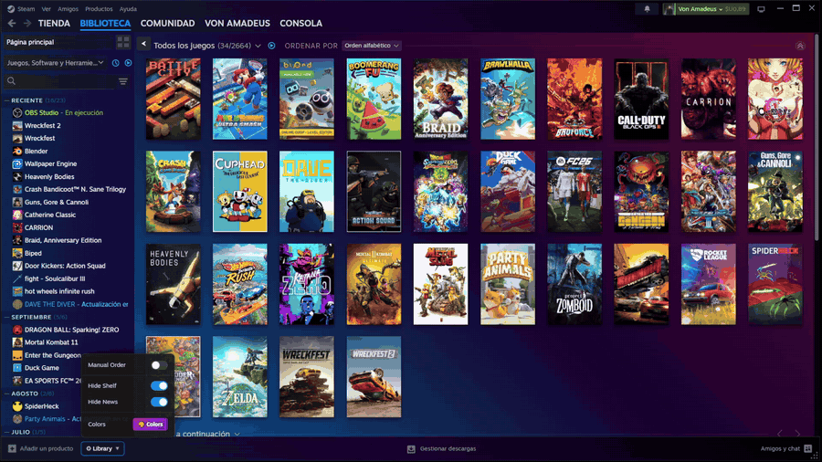
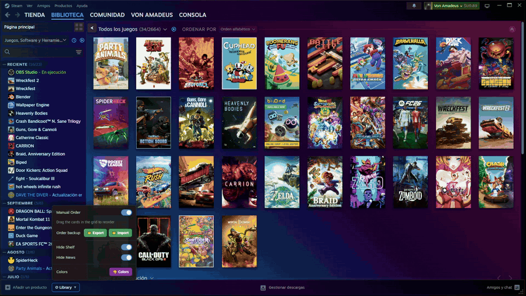

# Steam 2.0 Modular

## Description

Steam 2.0 Modular is an elegant and minimalist theme inspired by GOG 2.0 that modernizes the Steam experience. This theme focuses on simplifying the interface by removing unnecessary visual elements and reorganizing content more efficiently, all while maintaining the full functionality of Steam.

## Features

- **Manual game order**: drag the cards directly in the library grid.
- **Customizable gradients**: change the background of the library, game list, header/footer, downloads, buttons, friends list and Big Picture.
- **Gradient animations**: color rotate, radial and breathe, with an adjustable speed.
- **Ready-made presets** and a per-section **Reset**.
- **Hide Shelf** and **Hide News** toggles.
- Works in **any Steam language**, including Big Picture.

## Library controls

Open the **⚙ Library** menu at the bottom-left of the library window.

| Option | What it does |
| --- | --- |
| **Manual Order** | Turns custom ordering on or off. |
| **Order backup** | Export your order to a JSON file, or import one. |
| **Hide Shelf** | Hides the "Add shelf" button. |
| **Hide News** | Hides the "What's New" shelf. When shown, it uses the same gradient as the games grid. |
| **Colors** | Opens the color customization panel. |

### Reordering games

1. Turn on **Manual Order**.
2. Click and drag a card to a new position. The other cards move out of the way as you drag.
3. Release to save. The order is kept when you change tabs or reopen the library.

While Manual Order is on, dragging a card reorders it instead of adding it to a collection. Turn it off to get Steam's normal drag behavior back. Press **Esc** to cancel a drag.

If a filter is active (for example "Ready to Play"), games that are not visible keep their place in the saved order.

## Customize colors

Open **⚙ Library → Colors**. Each section has:

- Up to **6 colors** per gradient, each with its own opacity.
- An **angle** slider.
- A live **preview**.
- **Presets**: Sunset, Ocean, Aurora, Midnight, Plum, Forest, Ember and Graphite.
- A **↺ Reset** button for that section only.

Use **Apply & Save** to keep your changes. You can also **Export** and **Import** your colors as a JSON file, or **Reset** everything.

### Animations

Pick an animation in each section with the **Anim** dropdown, and set its speed with the **Speed** slider (1–20 seconds per cycle).

| Animation | What it does |
| --- | --- |
| **None** | Static gradient. |
| **Color Rotate (L → R)** | Colors cycle across the gradient from left to right. |
| **Color Rotate (radial)** | Colors cycle in circles from the center of the visible area outwards. |
| **Breathe** | The gradient fades in and out smoothly. |

Animations are drawn on a separate layer, so they only affect the background and never change the colors of your game covers.

## Friends list and Big Picture

- **Friends & chat**: changes made in the Colors panel apply to the friends window too.
- **Big Picture** needs one manual step, because Big Picture cannot read the theme settings:
  1. In **Colors**, edit the **Big Picture** section.
  2. Click **Save BP CSS**. The file `bigpicture.custom.css` is downloaded to your Downloads folder.
  3. Move it to `Steam\millennium\themes\Steam2.0-modular`, replacing the existing file.
  4. Restart Big Picture (or Steam).

The default Big Picture background is the same gradient as the games library, slightly transparent.

## Installation

1. Install [Millennium](https://steambrew.app).
2. Install **Steam 2.0 Modular** from the Millennium theme store, or copy this repository into `Steam\millennium\themes`.
3. Select the theme in Millennium settings and restart Steam.

## Notes

- Steam updates can change internal class names. If something stops working after an update, please [open an issue](https://github.com/Br1Rol2/Steam2.0-modular/issues).
- Some features rely on Millennium running theme JavaScript, so it must be enabled for this theme.

## License

Copyright © 2026 Von-Amadeus.

This theme is free software, licensed under the **GNU General Public License v3.0**. You can use, modify and share it, but any modified version you distribute must also be released under the GPL-3.0 with its source available, and keep the original copyright notice. See the [LICENSE](LICENSE) file for the full text.
